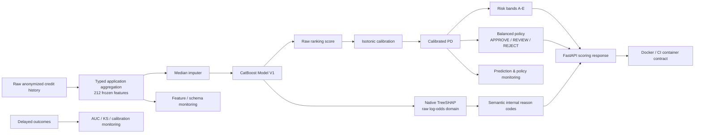

# Credit Risk Engine

**End-to-end credit-risk ML/MLOps portfolio project:** anonymized credit-history records → application-level features → CatBoost ranking model → calibrated probability of default (PD) → risk bands and decision policy → explainability → FastAPI/Docker serving → production monitoring.

> **Status:** portfolio release **M11**. Model V1 is frozen; M11 changes documentation/release validation only.

## Why this project is different from a notebook demo

This repository treats credit scoring as a **model lifecycle**, not only a classifier fit. The project includes controlled feature ablation, external validation, calibration, a frozen decision layer, a one-shot final lockbox evaluation, native TreeSHAP reason codes, training-serving consistency checks, a non-root Docker API, CI container tests, and label-free + delayed-outcome monitoring.

The dataset is anonymized. No claim is made that the coded fields have real-world semantics beyond what the data support, and the business economics are deliberately **illustrative normalized-EAD scenarios**, not estimates of a bank's actual pricing, LGD, or EAD.

## Headline results

| Milestone | Population / protocol | Main result |
|---|---|---|
| M1 baseline | 250k applications | Logistic ROC-AUC **0.7386** |
| M2.1 feature freeze | same 250k, 3-fold CV | 212-feature Logistic ROC-AUC **0.7435 ± 0.0022** |
| M3 nonlinear model | same frozen folds/features | CatBoost ROC-AUC **0.7553 ± 0.0027** |
| M3.2 external validation | frozen models on 750k applications | CatBoost ROC-AUC **0.7486** vs Logistic **0.7346** |
| M4 calibration validation | chunk 9 | Isotonic Brier **0.03120**, mean PD **3.72%** vs observed DR **3.31%** |
| M6 final lockbox | chunks 10+11, 500k applications | ROC-AUC **0.7168** (95% CI **0.7131–0.7206**), Brier **0.03107** |
| M6 frozen policy | same 500k | APPROVE **94.65%**, REVIEW **2.05%**, REJECT **3.30%** |
| M8 serving consistency | raw history → API vs frozen offline path | max PD difference **2.84e-09**; bands/decisions identical |
| M10 monitoring replay | reference 8+9 vs historical 10+11 | PD PSI **0.00074** but raw AUC fell **0.7353 → 0.7171** |

The final lockbox result is intentionally shown even though it is lower than the earlier external-validation score. Hiding that gap would make the project less credible. The monitoring layer uses it as a historical demonstration of why stable PSI/decision mix does **not** guarantee stable discrimination.

## System architecture



See [docs/ARCHITECTURE.md](docs/ARCHITECTURE.md) for the training/governance, serving, and monitoring flows.

## Data governance

The 12 training-history chunks were assigned roles **before** the corresponding later-stage evaluations:

| Chunks | Role |
|---|---|
| 0 | initial development / feature-model experiments |
| 1–3 | external frozen-model validation |
| 4–7 | added to final base-model training population |
| 8 | calibration fit |
| 9 | calibration method validation; later part of policy/reference population |
| 10–11 | final lockbox, opened once in M6 |

**Important:** chunks 10–11 are now historical evaluation data (`OPENED_AND_EVALUATED`). They must not be described as an untouched test set for future model development. Chunk numbers and `rn` are not treated as proven timestamps, so this repository does **not** claim temporal drift merely from chunk ordering.

Full governance details: [docs/GOVERNANCE.md](docs/GOVERNANCE.md).

## Model V1

- **Representation:** `e_typed_catdist_payment`, 212 application-level features.
- **Base learner:** CatBoost, depth 6, learning rate 0.05, L2 leaf regularization 5, 314 trees.
- **Training population:** chunks 0–7 (~2M applications).
- **Calibration:** isotonic regression, selected on chunk 9 and refit on chunks 8+9.
- **Risk bands:** A–E frozen on chunks 8+9.
- **Primary policy:** `balanced` with `APPROVE` at PD ≤ 9.6%, `REVIEW` for 9.6% < PD ≤ 12%, `REJECT` above 12%.
- **Explanations:** native CatBoost TreeSHAP in pre-calibration raw log-odds space, aggregated into semantic feature families.

Detailed model card: [docs/MODEL_CARD.md](docs/MODEL_CARD.md).

## Reproduce the environment

Python 3.11 and 3.12 are exercised in CI; production Docker uses Python 3.12.11.

```bash
python -m venv .venv
source .venv/bin/activate
python -m pip install --upgrade pip
make install-dev
make static
make test
make release-check
```

Pinned serving dependencies live in `requirements/runtime.txt`. The frozen isotonic calibrator was serialized with `scikit-learn==1.9.0`; serving treats an `InconsistentVersionWarning` as a startup/readiness failure.

## Data

Raw Kaggle competition files are intentionally excluded from Git. Expected layout:

```text
data/raw/data_for_competition/
├── train_target.csv
├── train_data_0.pq
├── ...
└── train_data_11.pq
```

The project expects the `alfa-bank-pd-credit-history` competition data. See [docs/REPRODUCIBILITY.md](docs/REPRODUCIBILITY.md) for the stage-by-stage commands and artifact dependencies.

## Run the production API

The API consumes **raw credit-history rows**, not precomputed 212-feature vectors. This is deliberate: online scoring reuses the same aggregation implementation as offline training.

```bash
make verify-artifacts
make api
```

Endpoints:

- `GET /health` — process liveness.
- `GET /ready` — model readiness + artifact fingerprint.
- `GET /v1/model-info` — frozen model/policy metadata.
- `POST /v1/score` — single application scoring.
- `POST /v1/score/batch` — batch scoring (max 128 applications).

Example request payload: [`examples/m8_score_request.json`](examples/m8_score_request.json).

```bash
curl http://127.0.0.1:8000/ready
curl http://127.0.0.1:8000/v1/model-info
```

The serving contract exposes the SHA-256 fingerprint of the seven frozen Model V1 serving artifacts. Offline-vs-online validation on 10 applications produced maximum calibrated-PD disagreement of `2.841e-09`, with identical risk bands, decisions, and rounded scores.

## Docker

A production image requires the seven frozen serving artifacts listed in `deployment/serving-artifacts.txt`. Raw data are excluded from the build context.

```bash
make docker-up
python scripts/m9_container_smoke_test.py --base-url http://127.0.0.1:8000
docker compose exec credit-risk-api id -u   # expected: 10001
make docker-down
```

The Compose service uses a non-root user, read-only root filesystem, `tmpfs` for `/tmp`, dropped Linux capabilities, `no-new-privileges`, and a `/ready`-backed healthcheck.

## Production monitoring

Build/freeze the monitoring reference on chunks 8+9:

```bash
python scripts/build_m10_reference_profile.py
python scripts/build_m10_1_schema_reference.py
```

Historical M6 replay:

```bash
python scripts/run_m10_monitoring.py
```

Observed replay:

- median feature PSI: **0.00179**; P90: **0.00496**;
- localized warning: `pre_since_confirmed__max` PSI **0.12271**;
- PD PSI: **0.000739**;
- mean PD: **3.5430% → 3.5848%**;
- APPROVE: **94.68% → 94.65%**;
- raw ROC-AUC: **0.73532 → 0.71710** (warning);
- overall monitoring status: **WARNING**, 2 warnings, 0 critical.

The feature-family shift and AUC decline co-occurred; the project does **not** claim that the former caused the latter. See [docs/MONITORING_CASE_STUDY.md](docs/MONITORING_CASE_STUDY.md).

## Explainability

```bash
python scripts/build_m7_explainability.py
```

Global TreeSHAP analysis found that repayment-pattern, exposure/balance, utilization, credit-product-mix, and delinquency-pattern groups accounted for roughly 88% of mean absolute SHAP importance in the analyzed development sample.

SHAP values explain the CatBoost **raw log-odds**, not calibrated PD percentage points. Internal reason codes are predictive explanations for engineering/model-governance use; they are **not causal claims or compliance-approved adverse-action notices**.

## Repository map

```text
.
├── src/credit_risk/          # reusable model, feature, decision, API, monitoring code
├── scripts/                  # reproducible stage runners M1–M11
├── tests/                    # unit/API/deployment/release tests
├── docs/                     # model card, results, architecture, governance, case study
├── examples/                 # API payload example
├── deployment/               # production serving artifact contract
├── requirements/             # pinned runtime + dev dependencies
├── .github/workflows/ci.yml  # Python matrix + real container contract
├── Dockerfile
├── docker-compose.yml
└── Makefile
```

## Milestones

| Stage | Deliverable | Status |
|---|---|---|
| M1 | reproducible Logistic baseline | ✅ |
| M2 / M2.1 | typed feature engineering + controlled ablation | ✅ |
| M3 / M3.1 | CatBoost benchmark + controlled tuning | ✅ |
| M3.2 | external frozen-model validation | ✅ |
| M4 | calibrated PD layer | ✅ |
| M5 | frozen risk bands + decision engine | ✅ |
| M6 | one-shot final lockbox evaluation | ✅ |
| M7 | TreeSHAP + semantic reason codes | ✅ |
| M8 | production FastAPI | ✅ |
| M9 / M9.1 | Docker, CI, dependency/runtime compatibility | ✅ |
| M10 / M10.1 | monitoring + baseline-aware schema drift | ✅ |
| M11 | portfolio release + model card + release validation | ✅ |

## What I would change with real bank data

The anonymized competition dataset does not provide enough semantics for production credit policy. A real deployment would additionally require, among other controls, documented feature lineage, legally reviewed permissible-purpose features, leakage checks tied to actual event timestamps, segment/fairness analysis where protected-class governance permits it, reject-inference considerations, approved LGD/EAD/pricing models, adverse-action reason validation, challenger governance, outcome-maturity rules, and institution-specific model-risk validation.

## Documentation

- [Architecture](docs/ARCHITECTURE.md)
- [Model Card](docs/MODEL_CARD.md)
- [Consolidated Results](docs/RESULTS.md)
- [Monitoring Case Study](docs/MONITORING_CASE_STUDY.md)
- [Governance & Limitations](docs/GOVERNANCE.md)
- [Reproducibility Guide](docs/REPRODUCIBILITY.md)
- [Demo / Interview Walkthrough](docs/DEMO.md)
- [Changelog](CHANGELOG.md)

## Release validation

M11 adds a repository-level contract checker:

```bash
python scripts/validate_m11_release.py
# or
make release-check
```

It checks required portfolio docs, internal Markdown links, pinned Model V1 facts, lockbox wording, the `release/m11_release_manifest.json` contract, release version, and that no raw data/model binaries were accidentally packaged into a source-only release.

---

This is an educational/portfolio project, **not a production lending system** and not financial advice.
