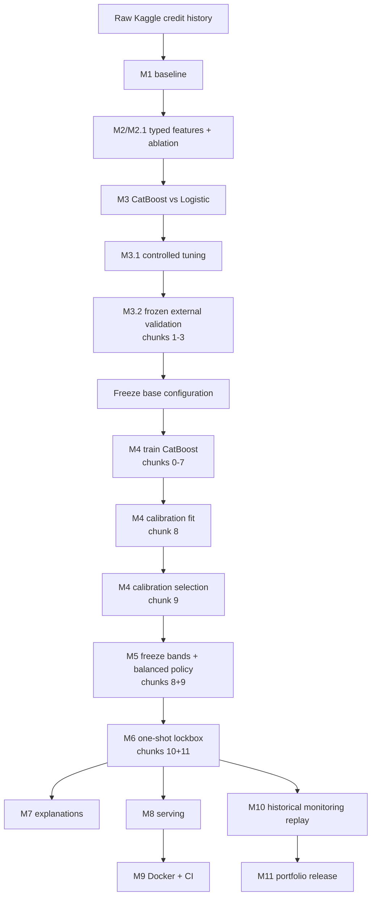
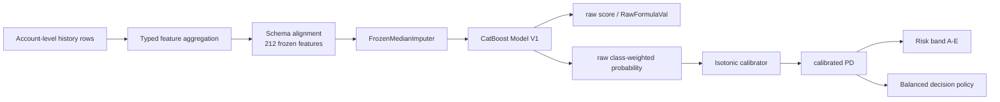
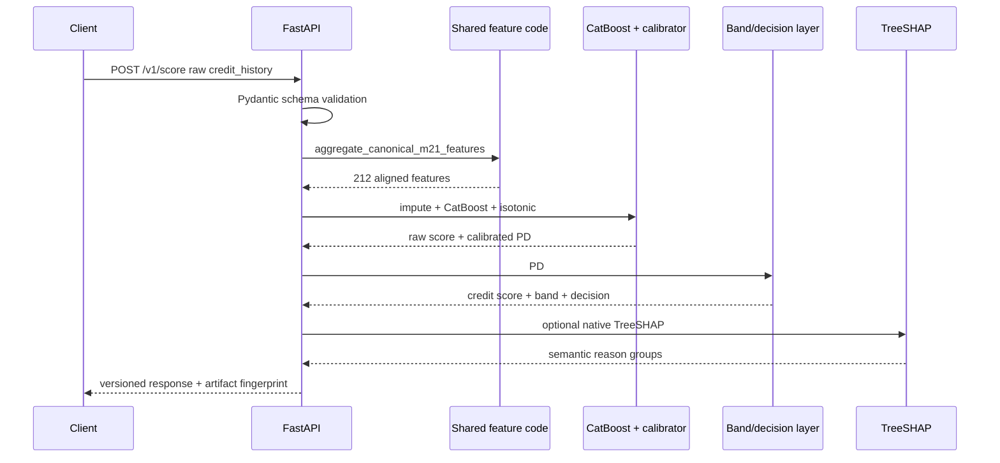
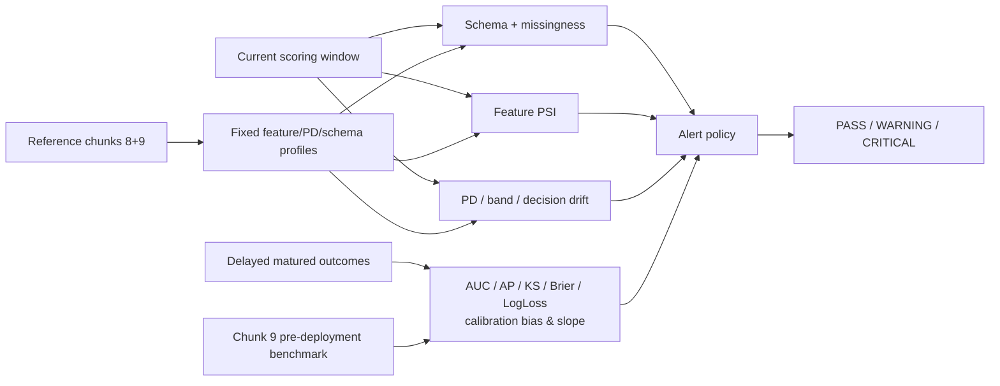

# Architecture

## 1. Experiment and governance flow

### Governance invariants

- M3.2 evaluates frozen M3/M3.1 candidates on chunks 1–3 without refitting.
- M4 chooses the calibration method on chunk 9 after fitting candidate calibrators on chunk 8.
- M5 policy/bands are frozen before M6.
- M6 opens chunks 10–11 once; afterward they are historical evaluation data.
- M10 thresholds were introduced after M6, so the M6 replay is retrospective, not a prospective alerting claim.

## 2. Offline feature/model path

`rn` is not assumed to be a real timestamp. The canonical M2.1 representation deliberately avoids the earlier `latest-by-rn` block.

## 3. Online serving path

The API never accepts the target label. Batch explanations are disabled by default because TreeSHAP adds latency.

## 4. Monitoring architecture

Monitoring explicitly separates **label-free signals** from metrics that require matured outcomes. This matters in the historical M10 replay: PD distribution and decision mix were stable while discrimination declined.

## 5. Deployment boundary

The production Docker image contains code plus only seven frozen serving artifacts. It excludes raw data, training caches, research plots, and other experiment artifacts. The application runs as UID/GID 10001, and readiness depends on successful artifact/runtime loading.
